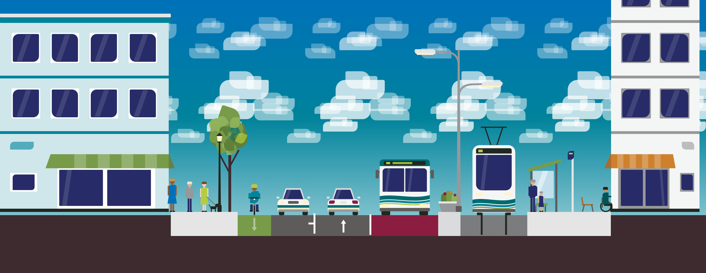
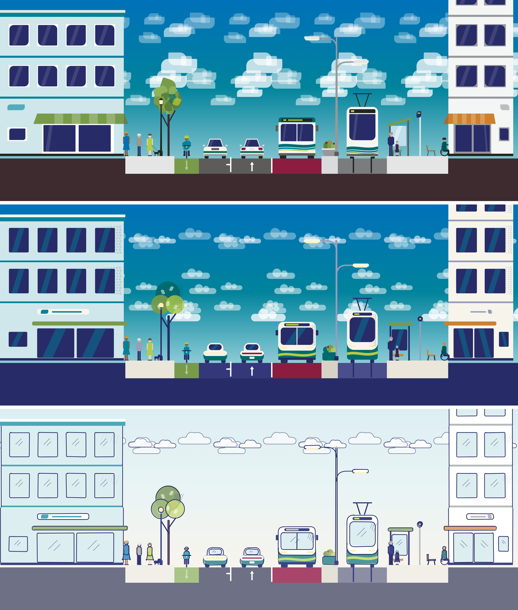
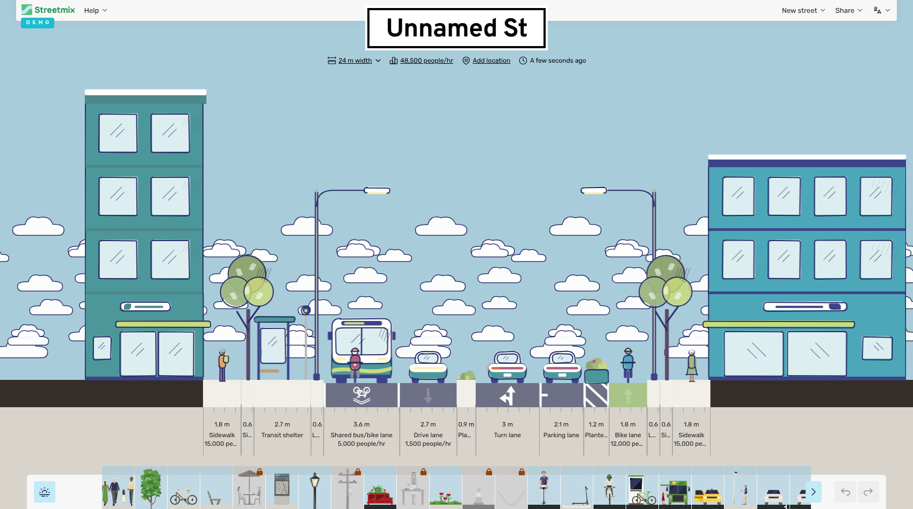

# VHB Streetmix restyle kit

Everything needed to reskin Streetmix in the VHB brand: the original graphics pulled apart and named, the VHB palette, and a complete redrawn sprite set that sits at the exact pixel positions the app already reads.

Figma file: https://www.figma.com/design/9fos3MOyiRGBFoWqXyMX1U



The scene above is a mock-up composed from the new art, not a capture of the running app.

## Three style iterations



| | Folder | Figma page | What it is |
|---|---|---|---|
| **A. Classic** | `vhb/` | 01, 03 | The first pass: the original Streetmix drawings re-thought in VHB colours and the logo's leaf shape. Detailed, close to the source proportions. |
| **B. Print** | `vhb-print/` | 05 | Seven inks on warm paper, no outlines, shapes that overprint each other, halftone dots for shade, midnight-blue roadway. |
| **C. Marker sketch** | `vhb-sketch/` | 06 | A loose ink line that overshoots its corners with flat marker colour dropped in slightly off-register, the way an urban designer renders a street section by hand. |

B and C share new, simpler geometry (one-box vehicles, lollipop trees, globe lamps, flat canopies, pictogram people) drawn once in `tools/art_modern.py` and rendered through two styles in `tools/styles.py`. Road markings are the same in all three because they follow real-world standards.

### Why these two directions

A short read of 2026 illustration and graphic-design trend writing gave a consistent picture:

- Flat shapes are still the base, but with one tactile layer on top: print grain and halftone, limited palettes, visible linework, a human hand.
- Bold, simple silhouettes over fine detail.
- Glossy soft gradients and blob-like 3D are now read as generic defaults, and the big-limbed "Corporate Memphis" figure style is exhausted. Low-poly faceting, which is what the original Streetmix art uses, belongs to the same earlier period.

So neither new iteration uses gradients inside sprites. B takes the printmaking and limited-palette route; C takes the hand-drawn linework route, which also suits a firm of planners and engineers. These sources are trend roundups from design blogs and agencies, not research, so treat them as direction rather than proof.

Sources: [Creative Bloq, illustration trends 2026](https://www.creativebloq.com/art/illustration/messy-meaningful-and-made-by-humans-the-biggest-illustration-trends-for-2026) · [Creative Bloq, graphic design trends 2026](https://www.creativebloq.com/design/graphic-design/texture-warmth-and-tactile-rebellion-the-big-graphic-design-trends-for-2026) · [Fireart, illustration trends](https://fireart.studio/blog/illustration-trends/) · [ManyPixels, icon design trends](https://www.manypixels.co/blog/post/the-key-trends-in-icon-design-in-2022) · [Made Good Designs, what's in and out](https://madegooddesigns.com/graphic-design-trends-2026/) · [Webflow, after Corporate Memphis](https://webflow.com/blog/after-corporate-memphis) · [GetIllustrations, styles to watch](https://getillustrations.com/blog/emerging-illustration-styles-to-watch-in-2026)

## Current Streetmix: branch `claude/vhb-sketch-upstream`

This fork's `master` is from June 2016. The sketch set has also been put onto a branch cut from the current
upstream `streetmix/streetmix` `main` (17 Nov 2026), where artwork is 338 individual SVG files rather than three
sprite sheets.



That screenshot is the real app, built and run locally from that branch. 154 illustrations are redrawn; 182 are
still the original art (35 road markings on purpose, the rest not drawn yet). The full lists are in
`packages/illustrations/VHB-SKETCH.md` on that branch. `tools/upstream_measure.js` and `tools/upstream_export.py`
here are what produced them.

## Implemented: the marker sketch set is now the 2016 app's artwork

Open `vhb-streetmix-sketch.html` in a browser to see it. It is one self-contained file that draws a live, editable street from the sketch sheets, using the segment definitions in `assets/scripts/segments/info.js` and the same crop coordinates and placement maths as the app. Switch to "Original art" in the header to see the old sheets through the same code.

What changed in the app itself:

| File | Change |
|---|---|
| `public/images/tiles-1/2/3.png`, `sky-front.png`, `sky-rear.png` | Replaced with the sketch versions (same pixel sizes) |
| `public/images/vhb-people.svg` | New: the 31 sketch figures as SVG symbols, in the format the loader expects |
| `app.js` | `/assets/images/images.svg` now serves `vhb-people.svg` instead of the `streetmix-illustrations` package |
| `assets/scripts/app/load_resources.js` | Tileset version bumped so browsers drop the cached sheets |
| `assets/css/_variables.scss`, `_sky.scss` | Sky, ground, lower background and segment-label colours retuned for the sketch art |

The originals are kept in `vhb-restyle/original/` and in git history.

**Not verified:** the full app was not started (it needs MongoDB and a 2016-era Node toolchain), so the SCSS changes and the people swap are untested in the real server. The standalone page is the evidence that the sheets line up.

## What the app draws, and where it comes from

| Graphic | Count | Source in the app |
|---|---|---|
| Segment sprites (vehicles, markings, furniture, trees, surfaces, shelters) | 97 crops | `public/images/tiles-1/2/3.png`, coordinates in `assets/scripts/segments/info.js` |
| Buildings and lots (narrow, wide, home, parking lot, waterfront, fence, grass) | 29 crops | same sheets, coordinates hard-coded in `assets/scripts/segments/buildings.js` |
| Sky | 2 | `public/images/sky-front.png`, `sky-rear.png`, plus `$sky-colour` in `assets/css/_variables.scss` |
| Sidewalk people | 31 | SVG symbols `people--people-01..31` from the external `streetmix-illustrations` package |
| UI icons | about 45 | external `streetmix-icons` package (ids listed in `assets/scripts/segments/variant_icons.js`) |
| "Learn more" photos | 20 | `public/images/info-bubble-examples/*.jpg` |
| UI colours and fonts | | `assets/css/_variables.scss`, `public/fonts` (Lato, Interstate, Roadgeek) |

Several crops share the same pixels (a parked car is a narrower crop of the same car, the home's upper floor is the top of its ground-floor sprite), so the 126 sheet crops come down to **115 distinct drawings**.

## What is in this folder

| Path | What it is |
|---|---|
| `manifest.json` | Every crop the app makes: name, sheet, pixel rectangle, and which segment variants use it |
| `art-objects.json` | The 115 distinct drawings with their exact footprint on each sheet |
| `original/` | The untouched sheets, each sprite sliced into its own named PNG, and a contact sheet |
| `brand-tokens.json` | VHB colours and fonts from the brand book, plus a suggested mapping for the app's SCSS colour variables |
| `vhb/`, `vhb-print/`, `vhb-sketch/` | The three iterations. Each has `sheets/tiles-1/2/3.svg` and `.png` (same size and layout as the originals), `sprites/`, `people/`, `sky/` and `preview/` |
| `FIGMA-PROMPT.md` | A self-contained brief for regenerating or extending the set in Figma or with an illustrator |
| `tools/` | The generator. Change a colour in `svgkit.py` or a drawing in `art_*.py` and rerun |

## Regenerating

Set the style first (`classic` is the default; the others are `print` and `sketch`):

```bash
export VHB_VARIANT=print
```

Then run the pipeline:

```bash
python3 tools/generate.py && node tools/render.js --probe && python3 tools/fit.py && python3 tools/generate.py && python3 tools/preview.py && node tools/render.js
```

The middle steps measure each sprite and nudge any that spill outside their footprint. Needs Python 3 with Pillow, and Node with Playwright.

## Design calls made

- **Shapes** come from the logo and the brand-book cover: the leaf/droplet for canopies, clouds, lamp heads, headlights and torsos; the three "mobility" curves as vehicle livery; square window grids.
- **Colour roles**: glass Midnight Blue, asphalt Dark Grey, sidewalk Light Grey, bike lane Leaf Green, bus lane Berry, vehicles white with a Teal band.
- **The VHB logo is not drawn into any sprite.**
- **Road markings stay white and traffic yellow.** The yellow is not a brand colour.
- **The banner stays a rainbow** because the app labels that variant "pride".
- **No lettering** anywhere except the "P" on the parking sign.

## Checked

- In all three iterations the sheets are the same pixel size as the originals.
- In all three, no new sprite paints outside the footprint of the sprite it replaces.
- The Figma file holds the same sheets as editable vectors, one named group per sprite.

## Not done

- **The app itself has not been run** with the sketch art; see the section above.
- **`streetmix-illustrations` may hold symbols besides the people.** The code in this repo only draws the people from it, but that package could not be opened here to confirm nothing else is lost by replacing it.
- **People**: the live app takes its 31 figures from the external `streetmix-illustrations` package, which this session could not open. The new figures follow the widths in `segments/people.js` but their box size is an assumption.
- **UI icons, favicon, "learn more" photos, UI colours and fonts** are inventoried above but not redrawn or changed.
- **Colour values** were sampled from the brand book PDF. Check them against the Brand Toolkit before anything ships.
